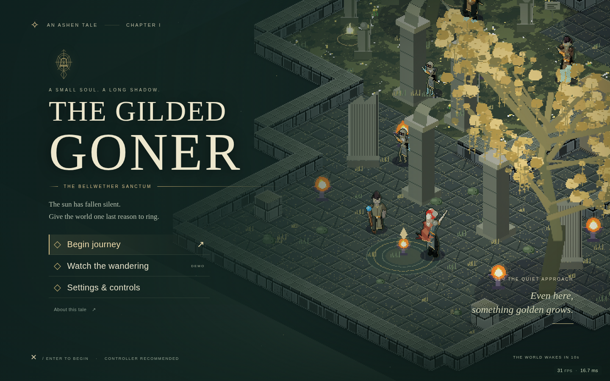

# The Gilded Goner

**A small soul. A long shadow.**

An original, controller-first action RPG set in the Bellwether Sanctum. Explore a ruined sanctuary, recover its stolen voice, and confront the last bellkeeper. One complete level, a combat proving ground, and a continuously playable arcade attract mode.

**[Play in your browser](https://michaelcrosato.github.io/TheGildedGoner-F3/)** · **[Download the offline edition](https://github.com/michaelcrosato/TheGildedGoner-F3/releases/latest)**



Repository identity: **TheGildedGoner-F3**, randomly selected from [50 candidates](docs/TITLES.md).

## Play

```sh
npm ci
npm run dev
# http://127.0.0.1:49173
```

No runtime dependencies, accounts, API keys, telemetry, downloaded assets, or online services. Use `GONER_PORT=49174 npm run dev` if the default port is occupied. The server binds only to loopback.

```sh
npm run build
```

Serve `dist/` on any static host, or open **`dist/TheGildedGoner-F3.html`** directly. The standalone file embeds the full game, engine, CSS and artwork. Browser-local saves are specific to the page origin; a local file and a hosted copy have separate saves.

## The journey

- Explore the Quiet Approach, Garden of Names, Amber Cloister, Fallen Choir and Unrung Cathedral in an interconnected authored level.
- Manage stamina, chain three light strikes, commit to heavy attacks, dodge through danger, guard and time perfect parries. Staggered foes take amplified ripostes.
- Fight pilgrims, lancers, shielded wardens, ranged cantors, and **Aurel**, a two-phase boss with an unblockable expanding shockwave.
- Find the Vesper glaive and an extra flask, recover the bell’s clapper, and bring it to Iona to learn her temporary echo companion. Chime bolts provide a ranged option.
- Rest to recover health, focus and flasks. Spend embers on permanent vigor and blade upgrades. Open the central shortcut to return quickly.
- Death leaves your unspent embers behind. Recover them before dying again. Equipment, quest progress, gates, upgrades and boss defeat persist.
- Ring the dawn bell for the ending, continue exploring afterward, or enter the resettable proving ground from the title’s **About this tale** screen.

The publisher’s [Elden Ring starter guide](https://en.bandainamcoent.eu/elden-ring/news/elden-ring-starter-guide-tips-know-playing-the-game) informed the reference pillars: thoughtful stamina use, restorative checkpoints and optional spirit assistance. This game has original characters, writing, locations, mechanics tuning, art and music; no source-game assets are included.

## Controls

DualSense uses the browser’s standard gamepad mapping. Connect by USB or Bluetooth and press a button to activate it. Menus accept left stick/d-pad, Cross to confirm and Circle to go back. Keyboard and mouse follow the same action model.

| Action | PlayStation-compatible pad | Keyboard / mouse |
|---|---|---|
| Move | Left stick | WASD / arrows |
| Light / heavy attack | R1 / R2 | J / K; left click for light |
| Guard / perfect parry | L1 | F / right click |
| Dodge | Circle | Space |
| Heal | Square | Q |
| Interact / rest | Triangle | E |
| Chime bolt | L2 | C |
| Call echo | D-pad up | R |
| Sprint | Hold L3 | Hold Shift |
| Lock on / release | R3 | Tab |
| Cycle target | D-pad right | V |
| Map & journal | Touchpad click (or Create) | M |
| Equipment | D-pad down | I |
| Pause | Options | Escape |
| Confirm / back | Cross / Circle | Enter / Escape |

A parry is the first 230 ms of a guard. Gold attack fans show the committed direction. Blue rings ignore shields: roll through them. Spend stamina deliberately; an empty guard breaks. Focus replenishes on kills and at rests.

## The wandering

After **10 seconds without physical input** on the title or its menus, an AI pilot starts a fresh journey. It navigates the real map, fights under the player’s rules, collects equipment, completes the quest, upgrades, kills the boss, rings the bell, then begins again. There are no bot damage bonuses, teleports, immunity, or scripted kills. Death and a watchdog keep an unattended kiosk moving. Any keyboard, mouse, touch, gamepad button or stick input returns immediately to the title.

Demo and proving-ground state never write the campaign save. Touch devices start the demo automatically and show only a menu button. There are no mobile movement controls.

## Checks and handoff

```sh
npm test                 # DOM-free engine-backed simulation tests
npm run build            # Static site and standalone HTML
npm run test:browser     # File://; Chromium, WebKit and Firefox, sequentially
npm run test:experience  # Served build: reload, ending, audio and WebKit phone
npm run bench           # 1080p frame-rate samples, one browser at a time
```

Playwright browsers are preinstalled on the development host. On a different machine install them with `npx playwright install chromium firefox webkit`. In this WSL environment retain `PLAYWRIGHT_HOST_PLATFORM_OVERRIDE=ubuntu24.04-x64`; do not run install-deps on Ubuntu 26.04.

The browser suite writes evidence outside the repository to `/tmp/goner-browser-qa`. Override with `GONER_QA_OUT`. `GONER_TEST_URL` tests a served build; `GONER_ENGINES=chromium` limits the engines. Runtime inspection is exposed only with `?qa`, at `window.__GONER__`.

- [Architecture and content guide](docs/ARCHITECTURE.md)
- [Verification evidence and limits](docs/VERIFICATION.md)
- [Requirement completion audit](docs/COMPLETION-AUDIT.md)
- [Engine evaluation](docs/ENGINE-EVALUATION.md)
- [Upstream engine API](docs/ENGINE-API.md)
- [Delivery contract](docs/PLAN.md)

## Source reference

This section is separate from the engine evaluation.

| Field | Confirmed information |
|---|---|
| Initial date | October 16, 2026, the first prompt in this session |
| SOURCE | Elden Ring (2022) |
| GAME ENGINE | [michaelcrosato/my-3d2dge](https://github.com/michaelcrosato/my-3d2dge), version **0.46.1**, commit `cfa866aa45474868350cad1a7fc015e612f9305f` |
| Environment | Codex CLI workspace; Ubuntu **26.04.1** on **WSL2**; Node **22.23.3**; Chromium, Firefox and WebKit via Playwright **1.63** |
| Target host | Intel Core i9-13900K; NVIDIA GeForce **RTX 3060 Ti**, driver 617.42, as reported by this machine |
| AI lab / model | **OpenAI; Codex based on GPT-6**, as identified in the session instructions |
| Reasoning effort | Not exposed by the session; no level is asserted |

## License

Game source: MIT. The vendored engine retains its own [MIT license](vendor/ENGINE-LICENSE); its small Canvas performance patch is documented in the engine evaluation. All game artwork and audio are generated by code. Elden Ring is referenced as inspiration; this is an independent original work.
